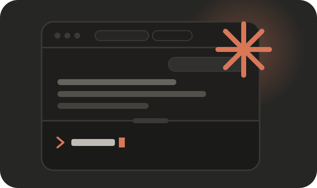

  

<h1 align="center">Claude Code Super UI</h1>

  <b>Run a whole team of Claudes. Lose track of none of them.</b> 
  The desktop app that turns Claude Code from one terminal window into a workshop you can actually see.

  <a href="https://github.com/j-east/super-ui-claude-code/releases/latest"><b>Download for Mac</b></a>
  &nbsp;·&nbsp;
  <a href="https://github.com/j-east/super-ui-claude-code/releases/latest"><b>Download for Windows</b></a>
  &nbsp;·&nbsp; Free and open source

---

## One Claude is a tool. Five Claudes is chaos.

Claude Code is one of the most capable AI builders around, and it lives in a terminal: a black window of
scrolling text. That works for one session. Then you open a second one for the website, a third for the
pitch deck, a fourth to chase a bug, and suddenly:

- Every tab is called `claude`, and you can't remember which is which.
- One of them asked you a yes/no question twenty minutes ago and has been sitting idle ever since.
- A beautiful answer with a table in it scrolled off the screen as garbled text.
- Two of them quietly built the same thing, two different ways.

Super UI fixes all four. You don't need to be a programmer to use it. If you can use Claude Code, you can
use this, and you'll get far more out of it.

## What it feels like

**Read it like a document, not a log.** Every session gets a clean, readable page: real headings, real
tables, highlighted code. The busywork Claude does along the way folds down to a line each, so you see the
thinking and the answers, not the plumbing.

**The real thing is still right there.** Under the page sits the actual Claude Code terminal, untouched.
Nothing is replaced or imitated. It's your login, your settings, your subscription. Type in it whenever you
want; it tucks itself away while Claude is working.

**Tabs that name themselves.** No more wall of tabs called `claude`. Each session writes its own label,
like "Pricing page redesign" or "Fix login bug", and keeps it current as the work moves on. They sit in a
tidy list down the left side, with a colored dot that tells you who's working, who's done, and who needs you.

**Questions come to you.** When Claude needs a decision, it shows up as a card with every option spelled
out. Click one. Done. No squinting at a terminal to find option 4.

**One inbox for everything.** Press `⌘I` and see every session at once: who's asking you something, who's
finished, who's still going. Answer questions right from the list.

**Side by side.** Split the window and watch two sessions at once.

**Pick up where you left off.** Every window becomes a workspace as you use it: it names itself after
the project and saves itself as tabs come and go. Close it, reopen it tomorrow, and every conversation
resumes. Closed a tab by accident? `⌘Z` brings it back.

## The Registrar: no boss, perfect memory

Most multi-agent tools put an "orchestrator" in charge: one AI that hands out work to the others. We think
that's the wrong shape. A manager AI becomes a bottleneck, forgets things, and takes you out of the
driver's seat.

Super UI does the opposite. **You** start a session when you have something to do, and close it when it's
done. Nobody is in charge but you.

What the app adds is a **Registrar**: a quiet observer that reads what your sessions are doing and keeps
the record. Think of the records office at a great research lab. It doesn't tell anyone what to work on.
It just knows what everyone has done.

- **In flight:** one plain sentence on what each session is doing right now.
- **Decisions on record:** the lasting choices your sessions have made, kept per project, even after you
  close the tab. What got built, which tools were picked, where things live.
- **Prior art:** when a session starts redoing something that already exists, or doing it a different
  way, the Registrar raises a flag and drafts a note. One click drops the note into that session. You
  decide whether to send it.

Sessions can also check the record themselves. Every Claude you start in the app gets one extra,
read-only tool: before it builds something new, it can ask what has already been decided. Your request
always comes first; the lookup happens only when the session thinks it needs one.

The result: your sessions stay independent and fast, and you stop paying twice for the same work.

## Get started in two minutes

You need [Claude Code](https://claude.com/claude-code) and a Claude subscription. If Claude Code isn't
installed yet, the app's start screen offers to install it for you.

**Mac (Apple Silicon)**

1. Download the `mac-arm64.zip` from the [latest release](https://github.com/j-east/super-ui-claude-code/releases/latest),
   unzip it, and drag the app to Applications.
2. The first time, macOS will refuse to open it, because the app isn't registered with Apple yet. Go to
   System Settings → Privacy & Security and click **Open Anyway**.

**Windows**

1. Download the `.exe` from the [latest release](https://github.com/j-east/super-ui-claude-code/releases/latest) and run it.
2. Windows will warn that it doesn't recognize the app, for the same reason. Click **More info**, then **Run anyway**.

The Windows version is new and experimental. If something breaks, [tell us](https://github.com/j-east/super-ui-claude-code/issues).

Open the app and you land on a start screen: launch Claude, pick a folder, or jump back into something recent.

## Questions people ask

**Do I need to know how to code?**
No. You need to be comfortable with Claude Code, and that's it.

**Does it cost anything?**
The app is free. It runs on your own Claude subscription. The tab labels and the Registrar use a small
amount of extra usage on your account, and you can switch either off.

**Is my work private?**
Everything runs on your own computer. Two features send anything anywhere: tab labels and the Registrar.
Each sends short excerpts of your sessions (your requests, the files changed, Claude's latest replies) to
Claude on your own account, the same place your sessions already go. The Registrar's record is stored on
your computer. Turn the Registrar off with the switch in its panel; see the
[developer notes](docs/DEVELOPMENT.md) for the settings that turn off labels.

**Is this made by Anthropic?**
No. This is an independent project. It is not made or endorsed by Anthropic. "Claude" and "Claude Code"
are Anthropic's trademarks.

**Does it change how Claude Code works?**
No. It runs the real Claude Code and reads the session history Claude Code already saves. It writes
nothing into your Claude settings or your projects. Inside the app, Claude starts with one extra read-only
tool for checking the Registrar's record; outside the app, nothing changes.

**What is Lunatic mode?**
A per-tab switch that answers Claude's prompts for you by pressing Enter on the first option. That means
it approves everything, including commands that delete or overwrite files. It is off by default, it asks
before turning on, and every automatic answer is noted. Use it only in a folder you could afford to lose.

## Shortcuts

On Windows, use `Ctrl+Shift` where the Mac uses `⌘` (so `Ctrl+Shift+T` for a new tab).

| | |
|---|---|
| `⌘T` | New tab |
| `⌘W` | Close tab |
| `⌘Z` | Reopen the tab you just closed |
| `⌘B` | Show or hide the tab list |
| `⌘I` | Inbox |
| `⌘J` | Jump to a session that is waiting on you |
| `⌘\` | Split view |
| `⌥⌘S` / `⌥⌘O` | Name this workspace / open a saved one |

## For developers

It's a thin native window (Swift on Mac, Electron on Windows) around a small Node server that runs one
real terminal per tab and follows Claude Code's session files. No Agent SDK, no hooks, no worktrees.
Building from source, the architecture, and the test loop are in [docs/DEVELOPMENT.md](docs/DEVELOPMENT.md).

## Status

Version 0.4, used daily by its author, and young. It reads Claude Code's screen and session files, which
Anthropic can change at any time, so a Claude Code update can break a feature until this catches up.

## License

[MIT](LICENSE). Use it, change it, ship it; it comes with no warranty.
