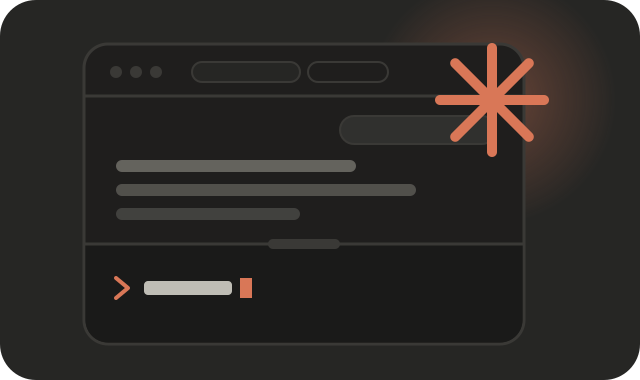

<p align="center">
  
</p>

<h1 align="center">Claude Code Super UI</h1>

<p align="center">
  <b>The conversation up top. The real terminal below.</b><br>
  A native macOS app for running several Claude Code sessions at once without losing track of any of them.
</p>

---

Claude Code is great in a terminal until you have five of them open. Long answers scroll away, tables wrap
badly, every tab is called `claude`, and somewhere one of them has been waiting on a yes/no for twenty minutes.

Super UI keeps Claude Code exactly as it is (the real CLI, in a real terminal, with your own login and
settings) and puts a proper reading surface on top of it: rendered Markdown, tabs that name themselves, one
inbox for everything that needs you, and questions you can answer with a click.

It does not replace Claude Code or talk to the API for you. It runs `claude` in a shell and reads the
session logs Claude Code already writes.

## What you get

**A transcript you can read.** Markdown, tables and highlighted code, rendered as Claude writes them. Tool
calls fold into one line each, with repeats grouped. Compactions become a divider instead of a wall of
text, and recaps show up as cards.

**A terminal that stays out of the way.** The terminal under the transcript is the real thing, and you can
type in it whenever you like. While Claude runs it shrinks to just the input box, and it grows back when
there is a dialog to see. Drag the divider to take over, double-click it to hand control back.

**Tabs that say what they are.** Each session gets a three to five word label and a one sentence summary,
written by a small headless `claude -p` run on Sonnet. Hover a tab for the summary, folder and state. The
tab bar scrolls with the mouse wheel when you have more tabs than room.

**Question cards.** When Claude asks you something (a permission prompt, a multiple choice question, a
multi-select with several steps) the whole question appears as a card under the transcript, with every
option and its description. Click to answer. No more enlarging the terminal to find option 4.

**One inbox.** `⌘I` lists every session in every window in three groups: asking you a question, finished
and waiting, and still working. Answer questions right there, or click a session to jump to it.

**Split view.** `⌘\` or drag a tab to the right half of the window to put two sessions side by side, each
with its own header saying which one it is.

**Workspaces.** Save a window's tabs under a name and reopen them later, with every session resumed where
it left off. A saved window keeps its workspace up to date as you add and close tabs, and the last session
is always saved for you. Closed a tab by mistake? `⌘Z` brings it back.

**Alerts.** A notification and a marked tab when a session finishes or needs input. `⌘J` jumps to the next
one waiting.

**A start screen.** New tabs open on a launcher: start Claude, pick a folder, resume a session, reopen a
saved workspace, or jump into a recent folder. If Claude Code is not installed, a setup card offers to install it.

**Also:** live preview of what Claude is doing right now, a "new messages" pill when you have scrolled up,
a warning before you quit with a task running, four themes, and drag tabs between windows.

## Install

Requirements: macOS 13 or later, [Node.js](https://nodejs.org) 20+, Xcode command line tools
(`xcode-select --install`), and [Claude Code](https://claude.com/claude-code).

```sh
git clone <this repo> claude-pane
cd claude-pane
npm install
npm run build:app
```

That builds `Claude Code Super UI.app`, installs it in `~/Applications` and registers it with Spotlight.
Open it like any other app.

To build a self-contained copy for another Mac (Node and everything else bundled, nothing to install):

```sh
npm run dist        # zip lands in dist.noindex/release/
```

Without a Developer ID the result is ad-hoc signed, so the other Mac will need right-click → Open the
first time. Set `SIGN_ID` (and `NOTARY_PROFILE`) to sign and notarize; see `scripts/build-app.sh`.

## Shortcuts

| | |
|---|---|
| `⌘T` / `⌘N` | New tab |
| `⇧⌘N` | New window |
| `⌘W` | Close tab |
| `⌘Z` / `⇧⌘T` | Reopen the tab you just closed |
| `⇧⌘]` / `⇧⌘[` | Next / previous tab |
| `⌘\` | Split view |
| `⌘I` | Inbox |
| `⌘J` | Jump to a tab that is waiting on you |
| `⌥⌘S` / `⌥⌘O` | Save / open workspace |
| `⇧⌘L` | Redraw the terminal |
| `⌘R` | Reload the window (sessions keep running) |

## Lunatic mode

Each tab has a 🌀 Lunatic button. When it is on, the app presses Enter for you on Claude's prompts
whenever option 1 is highlighted and you have not typed for three seconds.

That means it approves every tool call, including commands that delete or overwrite things. It is off by
default, it is per tab, it asks before turning on, and every automatic answer is noted in the transcript.
Use it in a folder you could afford to lose.

## How it works

```
┌──────────────────────────── Swift app (WKWebView windows, menus, notifications)
│
│   ┌──────────────────────── page: transcript, tabs, inbox, xterm.js
│   │        ▲ websocket (127.0.0.1, token + origin checked)
│   │        ▼
│   └── Node server ── one pty per tab ── your login shell ── claude
│            │
│            └── follows ~/.claude/projects/…/<session>.jsonl for the transcript
```

- **`native/`** The macOS shell: windows, menus, notifications, quit warnings. It starts the server and
  stops it when the app quits.
- **`src/`** The server. `tab.ts` owns a shell in a pty and a headless copy of its screen. `procwatch.ts`
  notices when `claude` starts in it, `transcript.ts` follows that session's log, `screen.ts` reads
  dialogs off the screen, `labeler.ts` writes tab labels.
- **`public/`** The page, in plain JavaScript modules with no build step.

Development loop: `npm run build:app` once, then `⌘R` picks up changes to `public/`. Changes to `src/` or
`native/` need `npm run build:app` again and an app restart. `npm run dev` runs the server alone and opens
it in a browser window.

## Privacy

Everything runs on your Mac. The server listens on `127.0.0.1` only and every connection needs a random
per-launch token.

One feature sends anything anywhere: tab labels. To write a label, the app passes a short excerpt of the
session (folder, title, your first and latest requests, Claude's latest reply) to `claude -p` on your own
Claude account, the same place the session itself already goes. Turn it off with `CLAUDE_PANE_NO_LABELS=1`.

## Status

Version 0.2. It is used daily by its author and it is young. It reads Claude Code's screen and log format,
neither of which is a public interface, so a Claude Code update can break a feature until this catches up.
macOS only.

This is an independent project. It is not made or endorsed by Anthropic. "Claude" and "Claude Code" are
Anthropic's trademarks.
